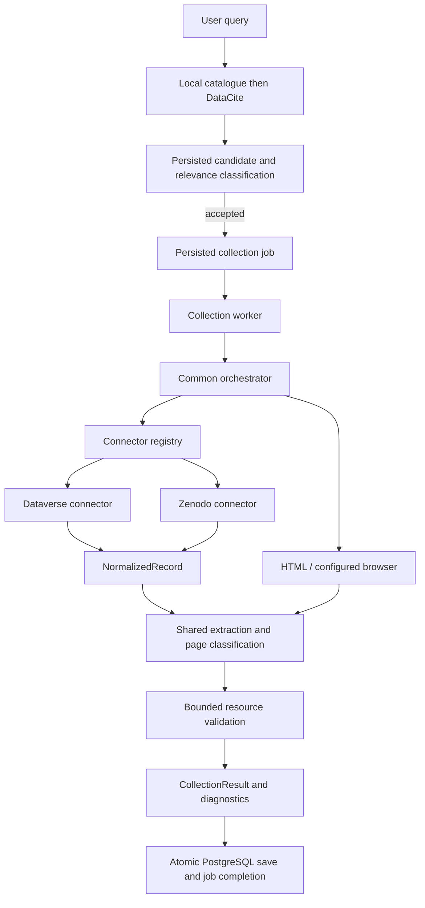

# Collection connectors

Implemented foundation, 2026-10-12. See [architecture decision](adr/0002-collection-connectors.md)
for the long-term target and remaining stages.

## Runtime

The API/HTML/browser sequence shares the resource-check limit, save limit and
total budget. A valid classification refusal stops collection. An authoritative
empty API listing stops navigation; a malformed or missing listing is a failure,
not proof of emptiness. Recovery preserves failed methods in history without
turning a later validated result into a failure.

No connector downloads complete datasets. Resource validation retains bounded
sample semantics. Browser probes use the same isolated session as rendering;
cookies remain in the browser service.

## Modules and dependencies

| Module | Responsibility |
| --- | --- |
| `collection/records.py` | Normalized observations and scoped identity |
| `collection/connectors/__init__.py` | Record connector protocol |
| `collection/connectors/dataverse.py` | Dataverse response validation and scope |
| `collection/connectors/zenodo.py` | Zenodo response validation and scope |
| `collection/registry.py` | Trusted connector selection |
| `collection/compatibility.py` | Bridge to existing classification contracts |
| `collection/pipeline.py` | Common extraction and classification |
| `collection/orchestrator.py` | Attempts, fallback, limits, validation and reporting |
| `collection/browser.py` | Generic browser-service client and session probes |
| `backend/app/collection_worker.py` | Configuration, votes/traces and completion |
| `backend/app/db/collection_completion.py` | Existing guarded atomic finalization |

`collection/strategies/dataverse.py` remains a compatibility wrapper. The reserved
`discovery/adapters/dataverse.py` concerns catalogue discovery, not record collection.

## Supported references

Dataverse resolves configured HTTPS instances, `dataset.xhtml` and `citation`
references with a persistent ID, and `file.xhtml` references with a file ID or
persistent ID. Explicit dataset versions continue through the original HTML/
browser page instead of the default latest-version API.

File metadata can be an object, a one-element wrapped list, or an unwrapped
one-element list. The download ID comes from `dataFile.id`, never the enclosing
file-metadata version ID. Ambiguous lists, missing identifiers and detected
identity mismatches fail resolution.

File resolution uses `/api/v1/files/{id}` or
`/api/v1/files/:persistentId?persistentId=...`, not the `/metadata` endpoint.
The latter can return a limited metadata object without the data-file identity
needed for collection. Explicit file versions use `/versions/{version}`.
See [the native file API](https://guides.dataverse.org/en/latest/api/native-api.html#get-json-representation-of-a-file).

## Failure evidence

`collection/http.py` returns the payload together with its actual HTTP status and
final URL. `collection/failures.py` separates transport, response decoding and
connector normalization failures. The orchestrator records HTTP evidence before
normalizing; a received HTTP 200 with incompatible metadata is reported as
`repository_metadata_invalid`, not an unreachable repository.

Method observations expose `failure_phase` and a controlled `reason`. Phases are
`fetch`, `decode`, `normalize`, `render`, `access`, `classify` and `validate`.
`repository_http_error` preserves a remote HTTP refusal; network failures and
timeouts have separate codes. A 202 alone never establishes an anti-bot barrier:
the HTML access detector must find supporting content.

Browser service HTTP failures use `service_http_status`, separate from the
repository page's `http_status`. Worker navigation failures, timeouts, process
exits and malformed service responses have distinct controlled codes. Optional
API metadata failure is retained as `metadata_code` / `metadata_http_status`
without discarding usable rendered HTML. No raw exception, page, cookie or
service error body is exported. Existing traces keep their historical evidence;
a corrected run does not reconstruct missing historical causes.

The existing JSONB observations store these additive fields; no schema migration
or new endpoint is needed. Successful fallback clears unresolved final errors
while retaining earlier failed method observations.

Zenodo resolves `/record/{id}`, `/records/{id}`, and `/files/{filename}` references
under those paths. It requests that exact record ID, not a latest or concept
record. The connector supports the published records API's list-shaped file
inventory. Unknown response shapes fail rather than silently becoming empty.
Filenames are decoded for selection. A file reference resolves only that file;
its parent DOI is stored as a parent reference, not assigned as a file DOI.

Fallback links are restricted by each connector for file references. Known API
resource URLs can be reused; otherwise the original reference must establish
scope. A parent's canonical HTML link cannot replace a recognized requested
record URL. Successful API identity remains available after HTML recovery.
If the API never resolved, identity retains only fields established by the
original reference; unknown API fields remain absent. HTML parent citation DOIs
are not assigned to individual file records.

## Configuration

- `COLLECTION_DATAVERSE_HOSTS`: defaults to `dataverse.harvard.edu`.
- `COLLECTION_ZENODO_HOSTS`: defaults to `zenodo.org`; empty disables recognition.
- `COLLECTION_BROWSER_HOSTS`: independently controls optional browser use.
- Existing duration, concurrency and resource limits retain their meaning.

Adding a host to a family is deployment configuration, not another connector.
A browser host is not enabled by API recognition.

## Adding a connector

Implement `supports`, `api_url`, `reference_identity`, `normalize`, and `scope_resources` under
`collection/connectors/`, then register it in `default_registry`. Use the supplied
bounded network path; normalization itself performs no I/O.
Recognition is separate from API availability: a pinned Dataverse dataset is
recognized but has no default API request, so HTML retains its requested version.

Tests must verify response structure, malformed data, exact identity, file scope,
versions where supported, authoritative emptiness, fallback and shared limits.
Do not add database writes or platform-dependent classification inside a connector.
Injected registries and fetch functions support tests without model calls.

## Persistence and rollout

Migration **13 to 14** adds an object-valued `record_identity` column. It records
platform, repository origin, kind, native ID, persistent ID and observed version
when available; file parent identifiers may also be present. API responses expose
the field additively. Existing rows remain readable with an empty identity.
HTML-only updates do not erase a previously stored identity.

This is a foundation for later migrations, not automatic DOI-based merging.
Dataset rows remain unique by URL. Distinct explicit version and file URLs stay
separate. Full version history, periodic revalidation and multi-instance leases
are future work, not enabled by this change.

Run tests against a disposable PostgreSQL database before deployment. Migration
runs at application initialization after deployment. This change does not deploy
the service or migrate a running production database.

Official references: [Dataverse](https://guides.dataverse.org/en/latest/api/native-api.html),
[Zenodo](https://developers.zenodo.org/#records).

## Verification, 2026-10-12

- Full Python suite: 1,148 passed, 8 optional proxy tests skipped. Container
  firewall tests were excluded; this change does not modify firewall rules.
- After the final partial-identity persistence adjustment, 166 targeted tests
  passed against the disposable PostgreSQL database, including the added
  sparse-identity preservation case and API/workflow regressions.
- Frontend: 88 tests passed and production build succeeded.
- Browser service: its local contract test passed.
- Application lint (`collector`, `backend`, `tests`, `browser`) and whitespace
  checks passed. Repository-wide lint still reports 43 pre-existing issues in
  four untracked `artifacts/debug-hiv` diagnostic scripts; they were not changed.
- Both Compose configurations validate with the optional browser profile.
- Live public Zenodo record `10075815` normalized successfully. One bounded
  resource sample returned HTTP 206 with ZIP evidence; no full file or model
  inference was requested and no catalogue row was written.
- A direct public Dataverse metadata request returned HTTP 403 in this
  environment. Parser fixture tests do not imply that an external access
  barrier has been removed.

No deployment or production database migration was performed. The temporary
test database is removed after verification.
