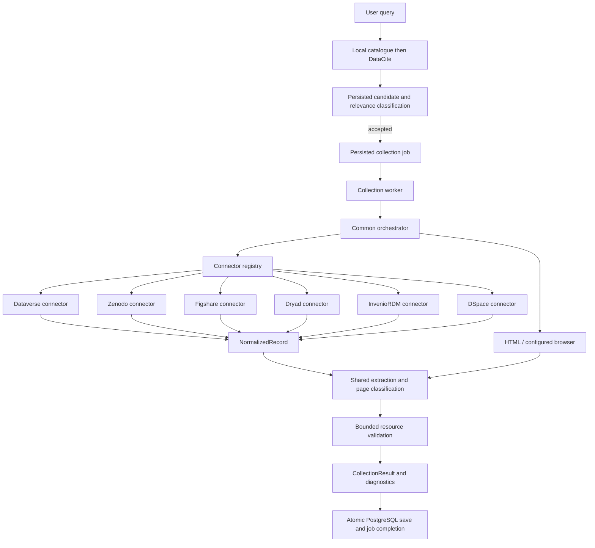

# Collection connectors

Use this reference when adding or changing a record connector. See the
[architecture decision](../adr/0002-collection-connectors.md) for the design
choices and extension boundaries.

## Runtime



The API/HTML/browser sequence shares the resource-check limit, save limit and
attempt budget, 300 seconds by default. Planned retry rounds get a fresh budget
on claim; the same attempt retains its deadline across acquisition recovery.
The independent LLM retry-planning window remains 120 seconds by default. A valid
classification refusal stops collection. An authoritative empty API listing
stops navigation; a malformed or missing listing is a failure,
not proof of emptiness. Recovery preserves failed methods in history without
turning a later validated result into a failure.

No connector downloads complete datasets. Resource validation retains bounded
sample semantics. Browser probes use the same isolated session as rendering;
cookies remain in the browser service.

## Modules and dependencies

| Module | Responsibility |
| --- | --- |
| `collection/records.py` | Normalized observations and scoped identity |
| `collection/service.py` | Public collection entry points and bounded source collection |
| `collection/connectors/__init__.py` | Record connector protocol |
| `collection/connectors/dataverse.py` | Dataverse response validation and scope |
| `collection/connectors/zenodo.py` | Zenodo response validation and scope |
| `collection/connectors/figshare.py` | Public Figshare article API and exact version validation |
| `collection/connectors/dryad.py` | DOI, selected Dryad version and paginated file listing |
| `collection/connectors/inveniordm.py` | Published InvenioRDM records and dedicated file metadata |
| `collection/connectors/dspace.py` | Published DSpace 7+ UUID items and ORIGINAL bitstreams |
| `collection/connectors/metadata.py` | API-confined, budgeted and bounded related metadata reads |
| `collection/registry.py` | Trusted connector selection |
| `collection/compatibility.py` | Bridge to existing classification contracts |
| `collection/pipeline.py` | Common extraction and classification |
| `extraction/limits.py`, `extraction/graph.py` | Bounded HTML/JSON-LD evidence and local Dataset identity selection |
| `extraction/source_identity.py` | Source identity derived from extracted evidence |
| `collection/orchestrator.py` | Attempts, fallback, limits, validation and reporting |
| `collection/browser.py` | Generic browser-service client and session probes |
| `network/fetch.py`, `network/transport.py`, `network/resolver.py`, `network/policy.py` | Shared bounded HTTP, DNS and destination policy |
| `backend/app/workers/collection/workers.py` | Configuration, votes/traces and completion |
| `backend/app/db/collection/reservations.py` | Candidate association and job reuse on the classification transaction |
| `backend/app/db/collection/completion.py` | Existing guarded atomic finalization |
| `backend/app/db/catalog/` | Dataset aggregates, distributions, observations and catalogue search |

`collection/strategies/dataverse.py` remains a compatibility wrapper. The former
`collector.main` entry points remain compatibility imports from
`collector.collection.service`; internal callers use the service directly.
Dataverse catalogue discovery has no dedicated adapter yet; record collection uses
the connector.

Public entry points in `collector.collection.service` and the record orchestrator use the same
pipeline. HTML/JSON-LD extraction limits and unresolved Dataset identity produce
controlled diagnostics; permitted later methods can recover while retaining the
failed method's evidence. Context documents are never fetched. Details and
validation are described in the [collection guide](collection.md).

## Structured source discovery

CKAN, Socrata and data.json discovery records the effective API/catalogue URL in
`metadata_source_url`; licence/date provenance therefore identifies the document
actually read, rather than an unvisited landing page. data.json landing pages and
download references resolve against the effective catalogue document URL, including
redirects. Supported JSON-LD Dataset type IRIs and local `@id` URL objects are
recognized without loading remote contexts or implementing general RDF expansion.

Socrata distributions retain the paginated SODA endpoint and instructions for
advancing through the dataset. Collection validates a bounded sample rather than
downloading all pages; see [resource validation and Socrata](collection.md#resource-validation-and-socrata).

## Supported references

These are **collection connectors**, not additional search-provider crawlers.
DataCite discovery and the local-first search policy are unchanged. Public record
metadata is normalized, then existing model votes and bounded access checks decide
whether a dataset can enter the catalogue. A supported repository is not automatic
proof that a record is a dataset or health-relevant. PDF publications, images and
HTML are excluded from eligible resources by format, extension or PDF MIME type.

### Dryad

The connector recognizes `https://datadryad.org/dataset/doi:10.5061/dryad.…`,
the `/stash/dataset/doi:…` variant and `/doi:…`. It retrieves the DOI record,
follows its selected version, and lists the version's files. DOI, version-to-dataset
relation and file-to-version relations are checked. Explicit version query
parameters are not silently replaced with the latest version. Downloads may still
require permission on the remote service; the connector does not authenticate or
claim that a listed file is accessible before validation.

### InvenioRDM

One connector supports `/records/{record_id}` (and `/record/{record_id}`) on
configured hosts, including opaque record IDs. Defaults are TU Wien Research Data,
CaltechDATA and CERN Repository:

```sh
export COLLECTION_INVENIORDM_HOSTS="researchdata.tuwien.ac.at,data.caltech.edu,repository.cern"
```

`/api/records/{id}` must identify the requested published record. The connector
uses `/api/records/{id}/files` for full file metadata; embedded summaries can omit
transfer status or content links. Completed file entries must point to the same
record's content endpoint. Disabled file storage is handled as metadata-only;
restricted access flags remain restricted. Drafts, collection pages and explicit
latest-version paths are not treated as pinned record references. Zenodo keeps its
separate existing connector and precedence.

### DSpace 7+ / DSpace-CRIS

The connector recognizes `/items/{uuid}` and `/entities/{type}/{uuid}` and maps
each landing hostname to its configured REST base. Defaults:

```sh
export COLLECTION_DSPACE_API_BASES='{"demo.dspace.org":"https://demo.dspace.org/server/api","www.zora.uzh.ch":"https://www.zora.uzh.ch/server/api","iris.unil.ch":"https://api.unil.ch/iris/server/api"}'
```

Item UUID, archive state and withdrawn state are validated. The connector reads
the item's bundles and only the `ORIGINAL` bundles' bitstreams. Thumbnails,
license artifacts and extracted text bundles are excluded. Content links must
match their bitstream UUID on the configured API, including the separate IRIS
API hostname. The item UUID identifies the selected item; another version's
UUID is not silently substituted. Legacy DSpace 5/6 REST APIs, Handle URLs and
ZORA legacy `/id/eprint/…` URLs are unsupported.

### Related metadata bounds

Related API reads share the existing collection deadline and metadata retry
policy. They are confined to the configured HTTPS API root, limited to 20 metadata
requests and five pages per listing. Cyclic links, missing lists, changed scopes,
inconsistent counts and truncated pagination fail explicitly rather than becoming
an authoritative empty result. Traces count all actual metadata requests, including
retries (up to 60). Without an established API file list, these connectors cannot
use arbitrary HTML links to broaden the record scope.

The source contracts are documented in the [Dryad API documentation](https://github.com/datadryad/dryad-app/blob/main/documentation/apis/README.md),
[InvenioRDM REST reference](https://inveniordm.docs.cern.ch/reference/rest_api_drafts_records/),
and [DSpace REST Contract](https://github.com/DSpace/RestContract).

### Figshare

Figshare resolves article pages on explicitly configured HTTPS hosts, defaulting
to `figshare.com` and `springernature.figshare.com`. Set `COLLECTION_FIGSHARE_HOSTS`
to a comma-separated list to configure institutional hosts; wildcards are not used.
The public API endpoint is always `https://api.figshare.com/v2/articles/{id}`.
For a page ending in `/{id}/{version}`, the connector uses
`/v2/articles/{id}/versions/{version}` and rejects a mismatched article or version.
Unversioned references preserve the actual version returned by the API.
File names, IDs, download URLs, embargo flags, license and publication date come
from the article response; the DOI of its associated publication is not substituted
for the dataset DOI. Direct download URLs and collections are not article references.
HTML/browser fallback for a pinned version retains only URLs proven by its API
listing; without that listing, it cannot establish version ownership of file IDs.
The connector shares metadata retries, model classification, bounded file checks
and the collection deadline. No anti-robot verification is bypassed or solved.

### Dataverse

Dataverse resolves configured HTTPS instances, `dataset.xhtml` and `citation`
references with a persistent ID, and `file.xhtml` references with a file ID or
persistent ID. Explicit dataset versions continue through the original HTML/
browser page instead of the default latest-version API.

File metadata can be an object, a one-element wrapped list, or an unwrapped
one-element list. The download ID comes from `dataFile.id`, never the enclosing
file-metadata version ID. Ambiguous lists, missing identifiers and detected
identity mismatches fail resolution.

File resolution uses `/api/v1/files/{id}` or
`/api/v1/files/:persistentId?persistentId=...`, not the `/metadata` endpoint.
The latter can return a limited metadata object without the data-file identity
needed for collection. Explicit file versions use `/versions/{version}`.
See [the native file API](https://guides.dataverse.org/en/latest/api/native-api.html#get-json-representation-of-a-file).

### Zenodo

Zenodo resolves `/record/{id}`, `/records/{id}`, and `/files/{filename}` references
under those paths. It requests that exact record ID, not a latest or concept
record. The connector supports the published records API's list-shaped file
inventory. Unknown response shapes fail rather than silently becoming empty.
It also recognizes `/doi/10.5281/zenodo.{id}`. Version DOIs retain their exact
record identity. A concept DOI may redirect to a published version only when
both `conceptrecid` and `conceptdoi` match the requested DOI; the observed
version's record ID and DOI are retained. PDF-only listings yield an empty
eligible-resource result without HTML fallback or inconclusive file checks.
Filenames are decoded for selection. A file reference resolves only that file;
its parent DOI is stored as a parent reference, not assigned as a file DOI.

## Failure evidence

`collection/http.py` returns the payload together with its actual HTTP status and
final URL. `collection/failures.py` separates transport, response decoding and
connector normalization failures. The orchestrator records HTTP evidence before
normalizing; a received HTTP 200 with incompatible metadata is reported as
`repository_metadata_invalid`, not an unreachable repository.

Method observations expose `failure_phase` and a controlled `reason`. Phases are
`fetch`, `decode`, `normalize`, `render`, `access`, `classify` and `validate`.
`repository_http_error` preserves a remote HTTP refusal; network failures and
timeouts have separate codes. A 202 alone never establishes an anti-bot barrier:
the HTML access detector must find supporting content.

Browser service HTTP failures use `service_http_status`, separate from the
repository page's `http_status`. Worker navigation failures, timeouts, process
exits and malformed service responses have distinct controlled codes. Optional
API metadata failure is retained as `metadata_code` / `metadata_http_status`
without discarding usable rendered HTML. No raw exception, page, cookie or
service error body is exported. Existing traces keep their historical evidence;
a corrected run does not reconstruct missing historical causes.

The existing JSONB observations store these additive fields; no schema migration
or new endpoint is needed. Successful fallback clears unresolved final errors
while retaining earlier failed method observations.

## Record scope and fallback

Fallback links are restricted by each connector for file references. Known API
resource URLs can be reused; otherwise the original reference must establish
scope. A parent's canonical HTML link cannot replace a recognized requested
record URL. Successful API identity remains available after HTML recovery.
If the API never resolved, identity retains only fields established by the
original reference; unknown API fields remain absent. HTML parent citation DOIs
are not assigned to individual file records.

## Configuration

- `COLLECTION_DATAVERSE_HOSTS`: defaults to `dataverse.harvard.edu,dataverse.unc.edu`.
- `COLLECTION_ZENODO_HOSTS`: defaults to `zenodo.org`; empty disables recognition.
- `COLLECTION_BROWSER_HOSTS`: independently controls optional browser use.
- `COLLECTION_MAX_DURATION_SECONDS`: defaults to 300 seconds per attempt; see
  [collection budget](collection.md#attempt-budget) for retry and recovery rules.
- Existing concurrency and resource limits retain their values.

Adding a host to a family is deployment configuration, not another connector.
A browser host is not enabled by API recognition.

## Adding a connector

Implement `supports`, `api_url`, `reference_identity`, `normalize`, and `scope_resources` under
`collection/connectors/`, then register it in `default_registry`. Use the supplied
bounded network path; normalization itself performs no I/O.
Recognition is separate from API availability: a pinned Dataverse dataset is
recognized but has no default API request, so HTML retains its requested version.

Tests must verify response structure, malformed data, exact identity, file scope,
versions where supported, authoritative emptiness, fallback and shared limits.
Do not add database writes or platform-dependent classification inside a connector.
Injected registries and fetch functions support tests without model calls.

## Persistence and rollout

The initial schema includes an object-valued `record_identity` column. It records
platform, repository origin, kind, native ID, persistent ID and observed version
when available; file parent identifiers may also be present. API responses expose
the field. Records without an observed identity use an empty object.
HTML-only updates do not erase a previously stored identity.

This supports later catalogue extensions, not automatic DOI-based merging.
Dataset rows remain unique by URL. Distinct explicit version and file URLs stay
separate. Full version history, periodic revalidation and multi-instance leases
are not implemented.

Run tests against a disposable PostgreSQL database before deployment. The single
initial migration creates the schema in an empty database at initialization;
earlier pre-release schemas require a fresh database. See
[schema operations](../DEPLOYMENT.md#schema-validation-and-retired-source-administration).

Official references: [Dataverse](https://guides.dataverse.org/en/latest/api/native-api.html),
[Zenodo](https://developers.zenodo.org/#records).
