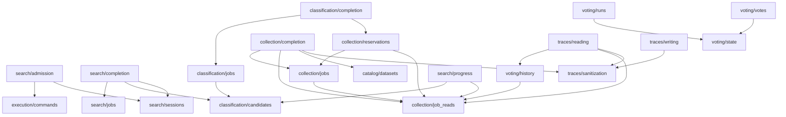

# Database architecture refactor

The refactor groups persistence by responsibility while retaining the original SQL,
transaction scopes, lock order, inputs and outputs. The existing route/presenter
renames and class docstrings were already in the working tree and are preserved.

## Final package layout

```text
db/
├── owner_ids.py
├── search/
│   ├── admission.py
│   ├── jobs.py
│   ├── completion.py
│   ├── sessions.py
│   └── progress.py
├── classification/
│   ├── candidates.py
│   ├── jobs.py
│   ├── completion.py
│   └── voting/
│       ├── runs.py
│       ├── votes.py
│       ├── history.py
│       └── state.py
├── collection/
│   ├── jobs.py
│   ├── job_reads.py
│   ├── reservations.py
│   ├── completion.py
│   └── traces/
│       ├── writing.py
│       ├── reading.py
│       └── sanitization.py
├── catalog/                 # existing catalogue modules
├── execution/               # existing shared coordination modules
├── migrations/              # unchanged SQL baseline
├── connection.py
├── schema.py
├── serialization.py
├── public_history.py
└── maintenance.py
```

All packages retain explicit `__init__.py` files. New initializers are documentation-only,
with no compatibility reexports. The former `classification/votes.py` and
`collection/traces.py` modules are replaced completely by their new packages.

## Placement decisions

- The requested `jobs.py` and `completion.py` convention is retained rather than
  the earlier proposed `result_commit.py` and `discovery_jobs.py` names.
- Candidate lifecycle SQL, including the connection-taking finalization primitive,
  belongs to `classification/jobs.py`. The public completion orchestrator still owns
  the transaction that also reserves collection.
- `collection/job_reads.py` contains the shared row conversion as requested. It is a
  leaf with respect to job mutations, so lifecycle writers can use the same conversion
  without a circular import or an additional forwarding layer.
- `voting/state.py` owns only parent/run locks and progress writes. It receives the
  caller connection and never starts an independent transaction.
- `traces/sanitization.py` owns pure evidence filters and the shared per-method check
  bound. The page-wide read bound stays in `reading.py`.
- `validate_owner_id()` is extracted from `_normalized_owner_id()`. The new name
  describes its existing behavior: reject surrounding whitespace, empty values or
  identifiers longer than 200 characters. Existing messages and accepted values stay unchanged.
- Schema, migrations, catalogue persistence, connection, serialization, public history,
  maintenance and shared execution implementations remain byte-identical.

## Dependency direction



Shared owner validation and connection/schema/serialization dependencies are omitted
from this diagram. The complete static DB import graph was checked for cycles.

## Preserved atomic operations

1. Search admission retains its command lock, idempotency fingerprint, capacity lock,
   quota updates, search creation/retry and receipt in the original transaction.
2. Search publication retains candidate insertion, downstream quota/capacity,
   candidate queueing and search finalization together. The existing inline and
   worker completion paths remain separate functions with their original behavior.
3. Classification completion keeps its guarded decision and collection reservation
   on the same connection. It still calls the private connection-taking reservation
   helper, never the public wrapper that opens another transaction.
4. Collection completion keeps the running-job lock, authoritative source URL,
   metadata enrichment, dataset/distribution/observation writes and final job update
   together. `mark_collection_job_done()` remains the narrower report-only operation.
5. Vote writes preserve parent/version lock → run lock → vote/attempt write → progress
   update. Retry lineage, successful vote reuse and parent version guards are unchanged.
6. Worker acquisition and claim receipts stay atomic, including replay after a lost
   commit reply. Startup recovery retains its existing call order.
7. Search progress retains `REPEATABLE READ READ ONLY`; trace/history reads retain
   owner checks, limits, ordering, truncation and repeated filtering of legacy evidence.

## File changes

| File | Change and reason |
|---|---|
| `backend/app/db/classification/candidates.py` | Reorganized. Candidate metadata, selection columns and row conversion remain a data leaf. |
| `backend/app/db/classification/jobs.py` | Created. Candidate claims, guarded row transitions and recovery share lifecycle ownership. |
| `backend/app/db/classification/voting/history.py` | Created. History reads own access checks, retry lineage and bounded public serialization. |
| `backend/app/db/classification/voting/runs.py` | Created. Prepare a fingerprinted reusable run and its configured votes. |
| `backend/app/db/classification/voting/state.py` | Created. Shared connection-taking locks and progress helpers prevent sibling cycles. |
| `backend/app/db/classification/voting/votes.py` | Created. Keep each claim/result/attempt/progress transaction intact, including restart recovery. |
| `backend/app/db/collection/completion.py` | Reorganized. Preserve both full dataset completion and the narrower report-only completion API. |
| `backend/app/db/collection/job_reads.py` | Created. Queries and row conversion are shared by lifecycle, reservations and progress reads. |
| `backend/app/db/collection/jobs.py` | Reorganized. Creation, claims, nonterminal/failure state and restart recovery remain lifecycle operations. |
| `backend/app/db/collection/traces/reading.py` | Created. Owned history assembly and pagination remain distinct from writes and filtering. |
| `backend/app/db/collection/traces/sanitization.py` | Created. One pure evidence policy is reused before persistence and before public exposure. |
| `backend/app/db/collection/traces/writing.py` | Created. Trace writes retain claim-version fencing and the same bounded resource checks. |
| `backend/app/db/owner_ids.py` | Created. Owner ID validation is shared by every domain; validation and messages are preserved. |
| `backend/app/db/search/admission.py` | Created. Command admission, quota charge and idempotency receipt share one transaction. |
| `backend/app/db/search/completion.py` | Created. Keep publication and terminal search writes in their existing atomic transactions. |
| `backend/app/db/search/jobs.py` | Reorganized. Worker acquisition, current-attempt quota/failure writes and restart recovery. |
| `backend/app/db/search/sessions.py` | Reorganized. Search creation, lookup, types and row representation stay together. |
| `backend/app/db/classification/voting/__init__.py` | Created a lightweight package initializer with no reexports. |
| `backend/app/db/collection/traces/__init__.py` | Created a lightweight package initializer with no reexports. |
| `backend/app/db/classification/votes.py` | Removed after all definitions and callers migrated to the new package. |
| `backend/app/db/collection/traces.py` | Removed after all definitions and callers migrated to the new package. |
| `backend/app/api/presenters/collection.py` | Updated imports/call sites to the owning modules; existing processing behavior and assertions retained. |
| `backend/app/api/routes/diagnostics.py` | Updated imports/call sites to the owning modules; existing processing behavior and assertions retained. |
| `backend/app/api/routes/searches.py` | Updated imports/call sites to the owning modules; existing processing behavior and assertions retained. |
| `backend/app/db/classification/completion.py` | Updated imports/call sites to the owning modules; existing processing behavior and assertions retained. |
| `backend/app/db/collection/reservations.py` | Updated imports/call sites to the owning modules; existing processing behavior and assertions retained. |
| `backend/app/db/search/progress.py` | Updated imports/call sites to the owning modules; existing processing behavior and assertions retained. |
| `backend/app/lifecycle.py` | Updated imports/call sites to the owning modules; existing processing behavior and assertions retained. |
| `backend/app/workers/classification/worker.py` | Updated imports/call sites to the owning modules; existing processing behavior and assertions retained. |
| `backend/app/workers/search/worker.py` | Updated imports/call sites to the owning modules; existing processing behavior and assertions retained. |
| `backend/app/workers/stores.py` | Updated imports/call sites to the owning modules; existing processing behavior and assertions retained. |
| `tests/helpers/database.py` | Updated imports/call sites to the owning modules; existing processing behavior and assertions retained. |
| `tests/test_async_searches.py` | Updated admission/completion imports and the downstream quota-failure monkeypatch target. |
| `tests/test_backend_persistence_review.py` | Updated imports/call sites to the owning modules; existing processing behavior and assertions retained. |
| `tests/test_collection_failure_details.py` | Updated imports/call sites to the owning modules; existing processing behavior and assertions retained. |
| `tests/test_collection_traces.py` | Updated imports/call sites to the owning modules; existing processing behavior and assertions retained. |
| `tests/test_collection_workflow.py` | Updated imports/call sites to the owning modules; existing processing behavior and assertions retained. |
| `tests/test_database.py` | Updated imports/call sites to the owning modules; existing processing behavior and assertions retained. |
| `tests/test_llm_recovery.py` | Updated imports/call sites to the owning modules; existing processing behavior and assertions retained. |
| `tests/test_search_progress.py` | Updated imports/call sites to the owning modules; existing processing behavior and assertions retained. |
| `tests/test_vote_persistence.py` | Updated imports/call sites to the owning modules; existing processing behavior and assertions retained. |
| `tests/test_worker_claims.py` | Updated the dynamically selected classification module used by claim and rollback tests. |
| `tests/test_worker_persistence.py` | Updated imports/call sites to the owning modules; existing processing behavior and assertions retained. |
| `docs/technical-design-document.md` | Describes module ownership, dependency direction and transaction boundaries. |
| `docs/ONBOARDING.md` | Updates the navigation table and search walkthrough. |
| `docs/reference/python-function-index.md` | Regenerated definitions, source paths and line links using the existing extractor. |
| `docs/reference/database-function-audit.md` | Records signatures, returns, SQL references, callers, dependencies and connection/transaction ownership for all 163 pre-existing functions/methods. |
| `docs/reference/database-refactor.md` | Records this migration and its preservation checks. |

## Function moves

Paths below are relative to `backend/app/db/`; old paths are migration history,
not active import instructions. Functions that remain in their original module
are covered by the complete audit linked below.

| Function | Previous file | New file | Reason |
|---|---|---|---|
| `_normalized_owner_id()` → `validate_owner_id()` | `search/sessions.py` | `owner_ids.py` | Owner ID validation is shared by every domain; validation and messages are preserved. |
| `admit_search()` | `search/jobs.py` | `search/admission.py` | Command admission, quota charge and idempotency receipt share one transaction. |
| `mark_interrupted_search_sessions_error()` | `search/sessions.py` | `search/jobs.py` | Worker acquisition, current-attempt quota/failure writes and restart recovery. |
| `complete_discovery()` | `search/jobs.py` | `search/completion.py` | Keep publication and terminal search writes in their existing atomic transactions. |
| `complete_search_session()` | `search/sessions.py` | `search/completion.py` | Keep publication and terminal search writes in their existing atomic transactions. |
| `_complete_search_session()` | `search/sessions.py` | `search/completion.py` | Keep publication and terminal search writes in their existing atomic transactions. |
| `save_local_results()` | `search/sessions.py` | `search/completion.py` | Keep publication and terminal search writes in their existing atomic transactions. |
| `complete_search_session_with_repository_candidates()` | `classification/candidates.py` | `search/completion.py` | Keep publication and terminal search writes in their existing atomic transactions. |
| `claim_candidate_classification()` | `classification/candidates.py` | `classification/jobs.py` | Candidate claims, guarded row transitions and recovery share lifecycle ownership. |
| `_complete_candidate_classification()` | `classification/candidates.py` | `classification/jobs.py` | Candidate claims, guarded row transitions and recovery share lifecycle ownership. |
| `fail_candidate_classification()` | `classification/candidates.py` | `classification/jobs.py` | Candidate claims, guarded row transitions and recovery share lifecycle ownership. |
| `mark_interrupted_candidate_classifications_error()` | `classification/candidates.py` | `classification/jobs.py` | Candidate claims, guarded row transitions and recovery share lifecycle ownership. |
| `prepare_vote_run()` | `classification/votes.py` | `classification/voting/runs.py` | Prepare a fingerprinted reusable run and its configured votes. |
| `claim_vote()` | `classification/votes.py` | `classification/voting/votes.py` | Keep each claim/result/attempt/progress transaction intact, including restart recovery. |
| `_check_vote_retry()` | `classification/votes.py` | `classification/voting/votes.py` | Keep each claim/result/attempt/progress transaction intact, including restart recovery. |
| `finish_vote()` | `classification/votes.py` | `classification/voting/votes.py` | Keep each claim/result/attempt/progress transaction intact, including restart recovery. |
| `mark_interrupted_votes_error()` | `classification/votes.py` | `classification/voting/votes.py` | Keep each claim/result/attempt/progress transaction intact, including restart recovery. |
| `read_candidate_vote_history()` | `classification/votes.py` | `classification/voting/history.py` | History reads own access checks, retry lineage and bounded public serialization. |
| `read_collection_vote_history()` | `classification/votes.py` | `classification/voting/history.py` | History reads own access checks, retry lineage and bounded public serialization. |
| `_read_vote_history()` | `classification/votes.py` | `classification/voting/history.py` | History reads own access checks, retry lineage and bounded public serialization. |
| `_scope()` | `classification/votes.py` | `classification/voting/state.py` | Shared connection-taking locks and progress helpers prevent sibling cycles. |
| `_lock_run()` | `classification/votes.py` | `classification/voting/state.py` | Shared connection-taking locks and progress helpers prevent sibling cycles. |
| `_publish_progress()` | `classification/votes.py` | `classification/voting/state.py` | Shared connection-taking locks and progress helpers prevent sibling cycles. |
| `get_collection_job()` | `collection/jobs.py` | `collection/job_reads.py` | Queries and row conversion are shared by lifecycle, reservations and progress reads. |
| `get_collection_job_for_owner()` | `collection/jobs.py` | `collection/job_reads.py` | Queries and row conversion are shared by lifecycle, reservations and progress reads. |
| `_get_collection_job_row()` | `collection/jobs.py` | `collection/job_reads.py` | Queries and row conversion are shared by lifecycle, reservations and progress reads. |
| `_job_dataset_ids()` | `collection/jobs.py` | `collection/job_reads.py` | Queries and row conversion are shared by lifecycle, reservations and progress reads. |
| `_collection_job_to_dict()` | `collection/jobs.py` | `collection/job_reads.py` | Queries and row conversion are shared by lifecycle, reservations and progress reads. |
| `mark_collection_job_done()` | `collection/jobs.py` | `collection/completion.py` | Preserve both full dataset completion and the narrower report-only completion API. |
| `_mark_collection_job_done()` | `collection/jobs.py` | `collection/completion.py` | Preserve both full dataset completion and the narrower report-only completion API. |
| `_collection_job_done_message()` | `collection/jobs.py` | `collection/completion.py` | Preserve both full dataset completion and the narrower report-only completion API. |
| `safe_url()` | `collection/traces.py` | `collection/traces/sanitization.py` | One pure evidence policy is reused before persistence and before public exposure. |
| `safe_resource_key()` | `collection/traces.py` | `collection/traces/sanitization.py` | One pure evidence policy is reused before persistence and before public exposure. |
| `safe_coverage()` | `collection/traces.py` | `collection/traces/sanitization.py` | One pure evidence policy is reused before persistence and before public exposure. |
| `safe_check()` | `collection/traces.py` | `collection/traces/sanitization.py` | One pure evidence policy is reused before persistence and before public exposure. |
| `safe_observation()` | `collection/traces.py` | `collection/traces/sanitization.py` | One pure evidence policy is reused before persistence and before public exposure. |
| `write_collection_trace()` | `collection/traces.py` | `collection/traces/writing.py` | Trace writes retain claim-version fencing and the same bounded resource checks. |
| `read_collection_trace()` | `collection/traces.py` | `collection/traces/reading.py` | Owned history assembly and pagination remain distinct from writes and filtering. |

## Full function audit

The [163-function inventory](database-function-audit.md) covers moved and unchanged
functions, including arguments/returns, SQL tables, static callers and dependencies,
and direct connection/transaction ownership. Static-reference limitations are stated
at the top of the inventory; dynamic module selection and monkeypatch targets were
also inspected through the existing regression suite.

## Verification

- Full suite with an isolated PostgreSQL 16 database: **1827 passed, 9 skipped**
  (`pytest -rN --tb=short`, 53.06 seconds).
- The nine optional Docker/proxy checks remain skipped: one egress-image test,
  five Traefik-image tests (including parameterized cases), and three opt-in load
  benchmark cases. `EGRESS_TEST_IMAGE`, `TRAEFIK_TEST_IMAGE` and
  `TRAEFIK_LOAD_BENCHMARK` were not configured. A targeted `pytest -q -rs` run
  confirmed these skip reasons. PostgreSQL persistence tests were executed.
- Ruff and `git diff --check`: pass. No type-checker is configured in the project.
- All **44 DB modules** import, and the static DB dependency graph is acyclic.
- All **212 original module-level definitions/constants** match after normalizing
  only docstrings, hoisted imports and the owner-validation identifier. This check
  includes signatures, SQL expressions, lock order and transaction bodies.
- Catalogue, schema, migrations, shared execution and infrastructure files are
  byte-identical to the pre-refactor working tree.
- All three captured OpenAPI variants (local, public HTTPS, public internal HTTP)
  match exactly, including paths, operation IDs, schemas and responses.
- The first full run reported 12 failures caused by two test indirections still
  targeting the old module ownership: the classification entry in the dynamic
  worker-claim registry, and the downstream `reserve_work` monkeypatch. Both were
  redirected to the actual owning modules; no assertions were removed or relaxed.
- No new business behavior, SQL schema migration or compatibility facade is part
  of this change. The temporary test database is removed after validation.
