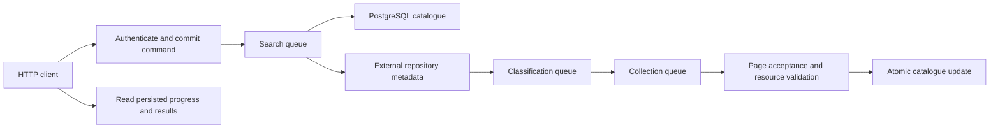

# Current architecture

This document describes the implemented system and its ownership boundaries.
HTTP fields and examples belong to [API integration](api-integration.md);
configuration and operating procedures belong to [Deployment](DEPLOYMENT.md).

## Scope and components

The project discovers dataset records, checks their relevance, validates access
to data resources, and stores catalogue metadata and links in PostgreSQL.
It does not download and retain complete datasets or implement publication approval.

The application is a modular monolith: the API and its three worker queues run
in one Python process. PostgreSQL persists the work; no external message broker
or independent worker service is required.

| Component | Responsibility | Source |
| --- | --- | --- |
| Optional Search Lab | Explore provider results with an independent local interface | [search_lab](../search_lab) |
| FastAPI backend | Authentication, validation, admission, workers and public responses | [backend/app](../backend/app) |
| Collector | Discovery, record extraction, LLM classification and resource checks | [collector](../collector) |
| PostgreSQL | Durable queues, ownership, receipts, votes, history and catalogue | [backend/app/db](../backend/app/db) |
| Optional browser service | Render selected pages and probe resources within browser sessions | [browser](../browser) |

Within the backend, `api/routes/` groups the search, catalogue, diagnostic and
session HTTP handlers. `api/router.py` assembles the `/collector` routes;
`app.main.create_app()` separately registers the session route at `/session`.
`api/schemas/` owns validation models, `api/presenters/` prepares public responses,
and the search presenter derives conclusions from saved progress. Request
middleware and shared progress reads remain directly in `api/`. `auth/` owns
access policy and anonymous sessions. Discovery preparation belongs to
`workers/search/discovery.py`. `policies/` contains quota and model-retry rules
shared across admission, storage and workers.

`workers/` executes background work through `SearchWorker`, `ClassificationWorker`
and `CollectionWorker`. They satisfy the structural `Worker` protocol in
`contracts.py`: a queue name and the methods `claim`, `execute` and `recover`.
The classes keep their own execution logic; the existing `runtime.py` manages
bounded consumers and shutdown, while `state.py` tracks ownership and health.

`sql_retries.py` retains outcomes during database failures. `FailureHandler` in
`failures.py` shares model-failure recovery between classification and collection.
`stores.py` bridges synchronous classifier/collector threads to asynchronous
PostgreSQL writes. `lifecycle.py` constructs the worker instances and starts and
stops their groups and the pool; `main.py` constructs the FastAPI application and
serves health/readiness.

`db/` owns SQL and transactions. Its `catalog/`, `search/`, `classification/`,
`collection/` and `execution/` packages separate domain records from shared
coordination. Within `catalog/`, `datasets.py` saves and reconstructs dataset
aggregates, `distributions.py` persists resource and validation evidence,
`observations.py` links discoveries to source jobs, and `search.py` performs
catalogue query normalization and PostgreSQL full-text search.
`search/admission.py` accepts or replays commands with their quota and idempotency
receipt in one transaction. `jobs.py` owns each domain's acquisition and lifecycle
transitions; it never calls providers or models. `completion.py` owns final writes
that must commit together. Search completion publishes local results or queued
candidates; classification completion saves a decision with its collection
reservation; collection completion saves datasets with the final job state.

`classification/candidates.py` stores candidate metadata and its row representation.
`classification/voting/` serves candidate and collection classifications alike:
`runs.py` prepares reusable runs, `votes.py` claims and finalizes attempts,
`history.py` reads bounded owner-scoped history, and `coordination.py` shares connection-taking
locks and progress writes. The state helpers never open another transaction.

`collection/reservations.py` reserves or reuses follow-up for accepted candidates.
`collection/job_queries.py` owns queries and the stored-job conversion shared by
reads and lifecycle writes; it does not import `jobs.py`. `collection/traces/`
separates `writing.py`, `reading.py` and pure `sanitization.py`. Writes and reads
apply the same evidence filters, including when publishing legacy stored traces.
Its shared check bound lives with the filtering policy; the page-wide read bound
stays in `reading.py`.

`owner_ids.py` validates identifiers for every domain. It rejects surrounding
whitespace, preserving the existing validation rather than silently normalizing it.
Connection, schema, serialization, history formats and maintenance remain at the
database package root. Production callers import the owning module directly,
without the former `app.database` re-export layer.

The package initializers contain documentation only. Shared leaf modules keep
imports acyclic: voting runs and votes depend on `voting/coordination.py`; trace reads
depend on vote history and job reads; mutations and reservations use job reads
for row conversion. The [database refactor report](reference/database-refactor.md)
contains the concrete file map, function moves and dependency graph.

The collector's public collection entry points are in `collection/service.py`.
They delegate to two explicit workflows: `collection/workflows/source.py` owns
`collect_source_with_report()` and its source-discovery, analysis and validation
helpers; `collection/workflows/record.py` owns candidate URL validation and
`collect_record()`, including the API → HTML → browser sequence, attempt history,
resource limits and reporting. The source workflow calls the record workflow
directly for its configured browser fallback; neither workflow imports the service.
The three shared callback type aliases live in `collection/contracts.py`.
`workflows/__init__.py` contains documentation only. The former `collection/orchestrator.py`
has been removed. The pipeline, connectors, resource checks and persistence
boundaries remain unchanged.

Within `workflows/record.py`, `collect_record()` retains method ordering,
fallback/stop decisions, phase transitions, exception handling and the `finally`
that publishes completed observations. Three private helpers keep the detailed
operations in the same module: `_fetch_record_metadata()` reads API metadata and
retains HTTP evidence and cumulative request attempts;
`_validate_record_resources()` runs the selected validator with shared check state
and records each resource check; `_build_collection_result()` assembles the
final report. Connector normalization remains after the fetch helper returns,
so transport failures stay in `fetch` and normalization failures stay in
`normalize`. Callback order, retry deadlines and partial-success reporting are
preserved.

`collector/main.py` remains a
compatibility import surface for `collect_source_with_report`,
`collect_repository_candidate_with_report`, `analyze_discovered_page` and
`analyze_html_page`, plus the `DiscoverFunction`, `FetchHTMLFunction` and
`ValidateDistributionFunction` type aliases. Internal callers import the service
directly. Source identification belongs to `extraction/source_identity.py`.

`collection/contracts.py` owns the page candidate shared by source discovery,
connector mapping, HTML resolution and browser rendering, along with
`StrategyResult`, `MethodAttempt`, diagnostic URL filtering and callback types.
The page keeps its existing public name `DiscoveredPage`, fields and defaults;
there is one definition, outside the discovery package. `collection/records.py`
remains the connector-normalized record and identity model, which has a different
role from a page candidate. `collection/record_mapping.py` explicitly maps that
record into `StrategyResult` through `to_strategy_result()`; it replaces the
vaguely named compatibility module without changing the mapping.

`collection/pipeline.py` remains the shared page preparation, evidence merging,
candidate filtering and classification pipeline. `collection/resources.py` owns
the shared `EXCLUDED_RESOURCE_FORMATS` policy, resource-check state and bounded
validation/retention. Both workflows reuse that policy and the existing pipeline;
no duplicate page model or additional abstraction layer is introduced. These
shared modules, the record workflow and the browser do not depend on source
discovery implementations.

Source exploration belongs to `collector/collection/discovery/`, distinct from
external candidate search in `collector/search/`.

`collector/search/` owns external provider calls, candidate filtering and metadata
normalization. Local catalogue lookup remains in the backend database layer;
source exploration remains part of collection. Application callers import the
search package directly. The directory rename preserves the existing function
and model names, the `repository_search` quota scopes and the
`repository_search_provider` event name.

```text
collector/
├── search/
├── collection/
│   ├── service.py
│   ├── contracts.py
│   ├── records.py
│   ├── record_mapping.py
│   ├── pipeline.py
│   ├── resources.py
│   ├── eligibility/
│   │   ├── __init__.py
│   │   ├── factory.py
│   │   ├── models.py
│   │   ├── classifier.py
│   │   ├── ensemble.py
│   │   └── prompts.py
│   ├── workflows/
│   │   ├── __init__.py
│   │   ├── source.py
│   │   └── record.py
│   ├── connectors/
│   │   ├── __init__.py
│   │   ├── registry.py
│   │   ├── http.py
│   │   ├── metadata.py
│   │   ├── shared.py
│   │   ├── dataverse.py
│   │   ├── zenodo.py
│   │   ├── dryad.py
│   │   ├── figshare.py
│   │   ├── dspace.py
│   │   └── inveniordm.py
│   └── discovery/
│       ├── __init__.py
│       ├── manager.py
│       ├── models.py
│       ├── metadata.py
│       ├── sitemap.py
│       └── adapters/
│           ├── __init__.py
│           ├── ckan.py
│           ├── socrata.py
│           ├── data_json.py
│           └── generic.py
└── network/
    ├── json.py
    └── ...
```

`collection/connectors/` groups the record connector protocol and platform
implementations with their registry and metadata transport. `registry.py` selects
configured connectors locally and preserves their existing order. `http.py` owns
`JsonResponse` and the bounded `fetch_record_json()` transport used by the record
workflow and connector metadata readers. It preserves HTTP evidence, request
limits, retry policy, deadlines and network protections. The protocol initializer
does not import either implementation, keeping imports acyclic. General public
JSON fetching for DataCite and source discovery stays in `network/json.py`.

`manager.py` runs the first adapter that recognizes the source. The registry in
`adapters/__init__.py` keeps the order CKAN, Socrata, data.json, then generic
website discovery, with per-run request settings. `discovery/models.py` owns
`DiscoveryAdapter` and the injected `JsonFetcher` contract, using the shared
`DiscoveredPage` from `collection/contracts.py`. `discovery/metadata.py` owns
adapter metadata normalization and vocabularies. Resource-format exclusions
belong to `collection/resources.py` and are imported by adapters and the pipeline.
`sitemap.py` retains sitemap parsing, ranking, traversal limits and bounded text
fetching; these operations are specific to source exploration.

`collector/network/json.py` owns `fetch_json_url()`, `JsonDocument` and
`document_url()`. DataCite and source adapters share this transport without
repository search depending on collection discovery. Effective response URLs,
JSON object/list handling, byte limits, deadlines, public-address and redirect
checks, exceptions and error messages remain unchanged. Callers import the owning
modules directly; the former discovery package and mixed `adapters/shared.py`
module are removed.

`collector/network/` groups HTTP fetching (`fetch.py`), connection and deadline
handling (`transport.py`), bounded DNS resolution (`resolver.py`) and the shared
public-address policy (`policy.py`). The package initializer does not import
these implementations, and `policy.py` needs only the standard library. Container
entrypoints can therefore import firewall address rules before loading the
application's dependency stack. General URL normalization stays in `url_utils.py`.

The DataCite provider separates request orchestration, result conversion and
metadata extraction:

```text
collector/search/providers/datacite/
├── __init__.py
├── client.py
├── mapping.py
└── metadata.py
```

`client.py` owns `DataCiteRepositorySearchProvider`, its injected `fetch_json`
transport, URL construction and public response/warning assembly. `mapping.py`
validates the response's data list, preserves usable result order and maps each
record to `RepositorySearchResult`, including the DOI resolver URL fallback.
Only the existing per-record `ExtractionError` is treated as omitted metadata;
fetch failures and unexpected normalization errors retain their propagation.
`metadata.py` owns field extraction, vocabularies, geographic validation and the
normalized dataset metadata mapping, without network calls. Request parameters,
page-size behavior, filtering, metadata defaults and errors are preserved.

The package initializer exports `DataCiteRepositorySearchProvider` through
`collector.search.providers.datacite`, the parent `collector.search.providers`
package and `collector.search`. Private conversion mocks
target `datacite.mapping`; default public JSON transport remains in
`collector/network/json.py`. Dependencies run from client to mapping to metadata,
without reverse imports.

`collector/extraction/` separates bounded HTML parsing, selected JSON-LD field
reading, metadata normalization and dataset/resource identification:

```text
collector/extraction/
├── __init__.py
├── extractor.py
├── html.py
├── text.py
├── json_ld.py
├── dataset_metadata.py
├── distributions.py
├── graph.py
├── limits.py
├── source_identity.py
└── errors.py
```

`extractor.py` keeps `extract_page()` as the public orchestrator assembling
`PageSnapshot`. `html.py` owns the page parser, links, HTML metadata and raw
JSON-LD script evidence. `text.py` owns the shared bounded parser base, normalized
HTML-to-text conversion and whitespace handling. This shared foundation lets
metadata helpers clean embedded HTML without depending on the page parser.
`html_to_text()` remains available through its existing `extractor.py` import.

`json_ld.py` reads publisher, geography, dates, license, size, modality and DOI
from the selected local evidence. Bounded JSON decoding and traversal remain in
`limits.py`; dataset disambiguation and local-reference resolution remain in
`graph.py`. `distributions.py` keeps resource extraction and ranking, while
`source_identity.py` keeps source-specific publisher/platform inference.

The existing `dataset_metadata.py` is retained and extended with page-text
normalization and inference helpers rather than adding a second metadata module.
Its ten-field contract, normalization functions and missing-value behavior are
unchanged. All parser callbacks, budgets, limits, exceptions, dataset-selection
rules and output fields are preserved. The extraction parser tests import private
classes from `html.py` and `text.py`; collection, classification and validation
implementations remain unchanged.

Relevance and eligibility classifiers are owned by their features; LLM infrastructure
is shared independently:

```text
collector/
├── llm/
│   ├── __init__.py
│   ├── client.py
│   ├── classifier.py
│   ├── voter_factory.py
│   ├── voting.py
│   ├── checkpoints.py
│   ├── errors.py
│   ├── prompts.py
│   └── providers/
│       ├── __init__.py
│       └── epfl_rcp.py
├── classification/
│   ├── __init__.py
│   └── relevance/
│       ├── __init__.py
│       ├── factory.py
│       ├── models.py
│       ├── classifier.py
│       ├── ensemble.py
│       └── prompts.py
└── collection/
    └── eligibility/
        ├── __init__.py
        ├── factory.py
        ├── models.py
        ├── classifier.py
        ├── ensemble.py
        └── prompts.py
```

`classification/relevance/` evaluates external repository candidates, including
DataCite results, against the user's query. The classification worker and search
service use its contracts and classifier. `collection/eligibility/` evaluates
dataset pages during collection; the collection pipeline uses its contracts and
classifier. Each domain
owns its models, bounded LLM payload and response parser, aggregation rules,
prompts and response schemas. Domain-specific helpers stay beside their callers.

`classification/relevance/factory.py` owns
`build_default_repository_result_classifier()`, used by `ClassificationWorker`.
`collection/eligibility/factory.py` owns `build_default_page_classifier()`, used by
`CollectionWorker`, the pipeline default and AI-enabled Search Lab. Both import
the same `_voters()` from `llm/voter_factory.py`. That shared module
retains the ordered model/credential configuration, checkpoint-aware client
construction and `validate_default_classifier_configuration()` used by readiness.
The former central classification factory is removed; internal callers import
the owning feature factory directly.

`llm/classifier.py` defines the abstract `BaseLLMClassifier[ResultT]`. Its inherited
constructor stores the injected client. `_classify_payload()` preserves known
`PipelineFailure` instances, wraps unexpected client exceptions with the feature's
`failure_message`, then invokes the abstract `_parse_response()` outside the error
handler. `LLMPageClassifier` and `LLMRepositoryRelevanceClassifier` inherit this
sequence while keeping their existing `classify()` signatures, payload builders,
limits and response parsers in their feature modules. The base does not import
feature models or prompts.

`llm/client.py` defines `LLMClassificationClient.classify_payload()` and the shared
HTTP implementation. `llm/checkpoints.py` provides `CheckpointedLLMClient`, which
implements the same method while reusing validated votes. `llm/voting.py` contains
`VoteOutcome` and `run_voters()` for parallel execution, plus the generic
`VotingEnsemble.evaluate()` for usable-vote checks, failures, acceptance thresholds
and supporting-vote selection. It returns an `EnsembleVotingResult`; its
`to_summary()` method preserves the existing persisted summary format while each
feature supplies its own individual-vote serializer.

The two feature ensembles use composition rather than inheritance. Eligibility
constructs `PageClassification`; relevance selects the final label, applies the
existing conservative tie order and combines missing information before returning
`RepositoryClassification`. Eligibility handles `ClassificationError`; relevance
also handles `ValueError`. Both retain their public constructor signatures,
properties and validation messages. The common engine calls the acceptance
threshold `minimum_accept_votes`, while the public feature parameter and stored
summary key remain `votes_required`. Likewise, `voter_failures` and
`supporting_votes` are internal result names; stored keys remain `failures` and
`decision_voter_ids`. No prompt, checkpoint or database format changes.

The eligibility prompt belongs to `collection/eligibility/prompts.py`: it defines
the collection-specific accepted-page decision and the `accepted`/`dataset_signals`
response schema, which evolve with that feature's models and parser. The
relevance prompt belongs to `classification/relevance/prompts.py`. Only
`llm/prompts.py` builds the common Chat Completions message envelope
and JSON schema instruction. Each feature factory supplies its own request-body
builder to `llm/providers/epfl_rcp.py` via `request_body_builder`. The provider
configures HTTP conventions without importing either feature. The two formerly
duplicated provider configuration functions are replaced by this single injectable
configuration builder; HTTP transport injection remains available to tests.

`llm/errors.py` owns `ClassificationError`, shared by relevance and eligibility
classifiers, the HTTP client and persisted vote recovery. Feature factories and provider
configuration assemble the classifiers using the shared transport and voting code.
Package initializers contain documentation only, and callers import the owning
modules directly without compatibility re-exports.

This separation preserves prompts, schemas, payload formats, voter identities and
order, thresholds, checkpoint fingerprints, retries and HTTP behavior.

Bounded access and format checks live in `collector/validation/distributions.py`;
they inspect response samples rather than downloading whole datasets.

Progress handlers and diagnostics share `api/search_progress.load_search_progress()`.
It reads an owner-scoped snapshot and passes it to the presenter; no HTTP handler
calls another route function. Each handler retains its response status, cache
headers and, for accepted commands, its progress URL.

Any HTTP client, including [scripts/api_client.py](../scripts/api_client.py), can
submit searches and follow the persisted workflow independently.
The browser service is a collection fallback, separate from the user interface.

## End-to-end flow



A search checks the local catalogue first. Without a local match, it queries
external providers; DataCite is the default provider. Normalized candidates are
saved and queued for relevance classification. A database lookup failure is an
error, never a reason to silently query external providers.
Local lookup uses PostgreSQL English full-text search, removing only generic
catalogue terms; the original query is retained for external search and prompts.

A positive repository decision reserves or reuses a collection job in the same
transaction. A saved matching dataset can satisfy that association immediately.
Repository metadata alone cannot publish a catalogue entry: collection must
independently accept the record page and validate at least one resource.

## Durable execution and lifecycle

[lifecycle.py](../backend/app/lifecycle.py) validates configuration, acquires exclusive
PostgreSQL ownership, opens the pool, and initializes or verifies the schema before
starting workers. `/health` checks process responsiveness; `/ready` also checks
runtime ownership, worker health, model configuration and database availability.

Run **one API process and one instance per database schema**, including during
migration or applying retention. An advisory lock on a dedicated connection
rejects a second owner. After schema validation, the runtime activates a new
ownership generation before recovering interrupted work. Claim transactions
check and lock that generation so a replaced process cannot claim or replay work.
Losing ownership stops new work and readiness. This is a safety boundary, not a
multi-instance scheduler or a high-availability design.

Search, classification and collection have separate PostgreSQL queues and bounded
executors. Consumers claim committed work with row locking; worker receipts and
attempt/version checks prevent an uncertain SQL acknowledgement from creating
another claim or allowing stale completion to overwrite a newer attempt.

`persisted_workers(worker, concurrency=...)` runs each worker instance through the
same acquisition, health and shutdown machinery. An instance holds configured
dependencies, which can be supplied explicitly for tests. Each call to `execute`
keeps its job, origin, version, result and persistence phase in local variables,
so several consumers can safely share one instance. Claims and finalization
delegate to the existing domain SQL functions and their transaction guards:
search uses an attempt token and number; classification and collection use the
claimed version, with owner checks where applicable.

Classification and collection use `FailureHandler` to persist an eligible LLM
continuation or a terminal error. Repairable storage failures during retry
scheduling retain the original model diagnostics until SQL acknowledges the
transition. A failure saving an already computed result only retries persistence
or records a persistence error. Search retains its own failure handling because
its local/provider origin and quota retry date are part of the discovery outcome.

Blocking provider and collector calls receive a copy of the execution context
in their worker thread, preserving cancellation and operational correlation.
Votes and collection traces travel back to the event loop through the shared
`stores._submit_and_wait` bridge. It waits with cooperative cancellation and closes
an unsubmitted coroutine when the loop rejects submission. Collection's attempt
budget covers computation; its final SQL transaction runs outside that budget.
The `PostgresCollectionTraceWriter` callback persists observations under the
current collection claim version.

The client submits a command and may disconnect immediately. Polling neither
starts nor advances work. Owner-scoped idempotency receipts bind command keys to
an operation and payload; replay returns the recorded search without readmission.
Reusing a key with incompatible content is a conflict.

Shutdown stops new claims and shares one bounded drain deadline across queues.
Queued work survives restart; interrupted running searches, classifications,
collections and votes receive explicit recovery states. Parent tasks are recovered
before their votes, preventing late checkpoints from reviving interrupted work.
Automatic LLM recovery
is bounded; eligible discovery or terminal task retries remain explicit commands.
See [backend lifecycle and persistence](DEPLOYMENT.md#collection-execution).

## Classification and collection boundaries

Repository relevance and page acceptance are separate decisions. Both default
ensembles use three configured model voters and require three usable responses,
including at least two positive votes. A valid negative vote is a decision;
an unavailable or malformed response is an error, not a negative vote.
Repository labels `relevant` and `somewhat_relevant` both count as positive.

Validated individual votes are checkpointed with the input, prompt/configuration
fingerprint and parser contract version. Compatible successful votes, including
negative votes, can be reused. Retry policy limits attempts and scheduling;
a response lost before durable storage can still require another paid call.
See [LLM recovery](reference/collection.md#model-retries-and-checkpoints).

For supported records, the collector tries a configured repository connector,
then HTML, then the optional browser when permitted. Supported connector families
are Dataverse, Zenodo, Figshare, Dryad, InvenioRDM and DSpace. A definitive semantic
rejection stops fallback; a provider's future retry date cannot be bypassed by
switching transport. Extraction-limit failures may move to a permitted fallback.

Resource checks are shared across methods, bounded and deduplicated. HTTP status,
headers and a small content sample establish technical availability; a filename,
MIME type, or successful HEAD alone does not establish a usable data resource.
A fully accessible paginated Socrata API can qualify without a complete-file export.
Ambiguous Dataset identities leave affected metadata empty instead of combining
unrelated records. Metadata provenance records where retained values came from.
See [Collection](reference/collection.md) and [connector contracts](reference/collection-connectors.md).

## Data relationships and transactions

- `search_sessions` owns the original query, owner, discovery attempt and state;
  `repository_candidates` belongs to a session, while `search_local_results`
  records the collected dataset IDs found locally.
- `application_ownership` fences runtime generations. `api_commands` persists
  idempotency receipts; `worker_claims` persists claim receipts; `api_rate_limits`
  supports atomic quotas and work admission.
- `collection_job_candidates` explicitly links candidates and jobs, including
  shared active collections. Job history and retry lineage remain distinguishable.
- `classification_runs`, `classification_votes` and `classification_vote_attempts`
  preserve reusable votes and their attempts. Method/resource trace tables record
  how a collection proceeded without treating an old snapshot as live evidence.
- `collected_datasets` owns `collected_distributions`;
  `dataset_discovery_observations` links successful observations to their jobs.
  The historical `data_sources` table has no active administration API.

Accepted classification and job association commit together: classification
completion calls the reservation helper on its existing transaction. Catalogue
dataset, distribution and observation helpers also use their caller's connection;
collection completion saves those records and the job outcome in one transaction.
A failed transaction cannot announce a saved dataset or completed job, and a
standalone dataset batch is rolled back in full if any member fails.
Catalogue records conflict on normalized dataset URL; distributions conflict on
`(dataset_id, url, format)`. Empty incoming descriptions preserve existing values.
Identity/provenance-aware enrichment can fill missing metadata after collection,
without making provider evidence authoritative over identified page/adapter evidence.

The catalogue is shared and publicly readable; search state, candidate decisions,
job reads and diagnostic histories are owner-scoped. Catalogue deduplication does
not provide comprehensive DOI, mirror or version equivalence. One initial
migration creates the complete version 1 baseline in an empty database,
including local/public search access modes. Repeated initialization preserves
records and owners. Earlier pre-release schemas are unsupported.
Retention is explicit, dry-run by default, and must preserve the chosen
idempotency window.

## Security, errors and operating limits

Deployment selects one access mode: local loopback identity or signed,
expiring anonymous visitor cookies. The server derives
ownership; clients cannot supply it. Visitor writes require the configured origin.
Quotas, queue capacity, bounded bodies and field validation protect admission;
CORS permits configured origins but does not replace authentication.

Untrusted collection URLs pass public HTTP(S), DNS-address and redirect checks.
Production containers add an independent egress policy. Configured model and
browser control endpoints are separate trusted settings, with their own secrets.
SQL values are parameterized. Provider content and prompt text remain untrusted.

Public progress separates execution (`queued`, `running`, `waiting_retry`,
`finished`, `failed`) from conclusion (`results`, `empty`, `incomplete`). While work
is active, the conclusion is unset. Valid partial results can be retained while
another branch remains incomplete. An error is never presented as an empty result.
Public errors and diagnostic exports use bounded, sanitized contracts; structured
operational logs correlate stages without exposing credentials or raw exceptions.
Full pages, session cookies and invalid model response bodies are not exported.
See [outcome contracts](reference/pipeline-outcomes.md) and [API integration](api-integration.md).

Collection has a default **300-second budget per attempt**, recorded at claim
time so uncertain SQL acknowledgements cannot reset it. A new retry round gets
a new budget, whether scheduled automatically or explicitly requested. Requests have
separate deadlines, and extraction, responses, resources and concurrency have
independent bounds. By default, a dataset checks at most three distinct resources
and retains one validated distribution. DNS waits use the same deadlines through
a bounded resolver; OS lookups themselves cannot be killed. See
[collection budget](reference/collection.md#attempt-budget).

Technical access and LLM relevance do not establish source authority, acceptable
licensing, absence of sensitive data, or permission to publish. Anonymous sessions
do not provide account management or institutional identity. Real-provider testing,
capacity planning and deployment review remain necessary for the intended use.
Client integration belongs to the [API guide](api-integration.md).

## Optional technical references

These contracts are for contributors changing a specific subsystem:

| Reference | Scope |
| --- | --- |
| [Collection](reference/collection.md) | Record identity, extraction, budgets, retries and browser recovery |
| [Connectors](reference/collection-connectors.md) | Repository-specific URLs, versions and connector development |
| [Pipeline outcomes](reference/pipeline-outcomes.md) | Execution states, completeness and safe diagnostics |
| [Visitor sessions](reference/anonymous-visitor-sessions.md) | Browser identity, cookie/origin policy and quotas |

[Architecture decisions](adr) retain the rationale for accepted design choices.

## Dependency boundary for the private web interface

The installable core contains `backend/app` and `collector`; it imports no
`interface_web` module. `app.main.create_app()` constructs a fresh core application,
and readiness uses the actual request application. The locally maintained web
interface can construct a core application and register additional routes; its
frontend, handlers, exclusive SQL and tests are all excluded from this repository.

Shared transaction/owner guards, quotas, vote history and collection traces remain
in the core because automatic processing and the full search diagnostic export
need them. Request and response models are grouped by domain in
`backend/app/api/schemas/`: `search.py`, `classification.py`, `collection.py` and
`catalog.py`, with shared diagnostics and HTTP errors in `common.py`. The matching
modules in `backend/app/api/presenters/` build client-safe responses from stored
data. The search presenter also derives the snapshot's execution status and
conclusion; these read operations never schedule processing.

Schema names describe their HTTP role without a `Collector` prefix: `Request`
is a client payload, `Response` is a complete endpoint response, and `View` is a
public nested object. Search uses `SearchCreateRequest`,
`SearchSubmissionResponse` and `SearchProgressResponse`; nested candidates,
classification, collection and catalogue objects use names such as
`RepositoryCandidateView`, `CandidateClassificationView`, `CollectionJobView` and
`CatalogDatasetView`. `CatalogDatasetsResponse` wraps the catalogue endpoint
result, and `HttpErrorResponse` describes an HTTP error body.
`SearchCreateRequest` declares its query validation directly rather than
inheriting a separate repository-search request model.

Search Lab, its interface, scenarios and tests remain versioned in `search_lab/`.
It observes the core API and PostgreSQL without executing application workers.
Neither public component imports the private web interface. The public test suites
and CI run without the private directory.
