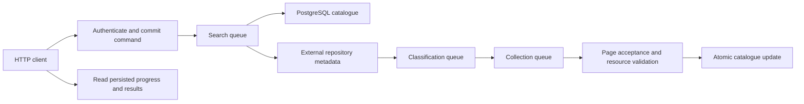

# Current architecture

This document describes the implemented system and its ownership boundaries.
HTTP fields and examples belong to [API integration](api-integration.md);
configuration and operating procedures belong to [Deployment](DEPLOYMENT.md).

## Scope and components

The project discovers dataset records, checks their relevance, validates access
to data resources, and stores catalogue metadata and links in PostgreSQL.
It does not download and retain complete datasets or implement publication approval.

The application is a modular monolith: the API and its three worker queues run
in one Python process. PostgreSQL persists the work; no external message broker
or independent worker service is required.

| Component | Responsibility | Source |
| --- | --- | --- |
| Optional Search Lab | Explore provider results with an independent local interface | [search_lab](../search_lab) |
| FastAPI backend | Authentication, validation, admission, workers and public responses | [backend/app](../backend/app) |
| Collector | Discovery, record extraction, LLM classification and resource checks | [collector](../collector) |
| PostgreSQL | Durable queues, ownership, receipts, votes, history and catalogue | [backend/app/db](../backend/app/db) |
| Optional browser service | Render selected pages and probe resources within browser sessions | [browser](../browser) |

Within the backend, `api/` owns HTTP handlers, models, response presentation and
request middleware. `auth/` owns access policy and anonymous sessions. `search/`
prepares discovery results and derives search conclusions; `policies/` contains
quota and model-retry rules shared across admission, storage and workers.

`workers/` executes background work through `SearchWorker`, `ClassificationWorker`
and `CollectionWorker`. They satisfy the structural `Worker` protocol in
`contracts.py`: a queue name and the methods `claim`, `execute` and `recover`.
The classes keep their own execution logic; the existing `runtime.py` manages
bounded consumers and shutdown, while `state.py` tracks ownership and health.

`sql_retries.py` retains outcomes during database failures. `FailureHandler` in
`failures.py` shares model-failure recovery between classification and collection.
`stores.py` bridges synchronous classifier/collector threads to asynchronous
PostgreSQL writes. `lifecycle.py` constructs the worker instances and starts and
stops their groups and the pool; `main.py` constructs the FastAPI application and
serves health/readiness.

`db/` owns SQL and transactions. Its `search/`, `classification/`, `collection/`
and `execution/` packages separate domain records from shared coordination.
Connection, schema, catalogue, serialization, history formats and maintenance
remain at the database package root. Production callers import the owning module
directly, without the former `app.database` re-export layer.

Progress handlers and diagnostics share `api/search_progress.load_search_progress()`.
It reads an owner-scoped snapshot and passes it to the presenter; no HTTP handler
calls another route function. Each handler retains its response status, cache
headers and, for accepted commands, its progress URL.

Any HTTP client, including [scripts/api_client.py](../scripts/api_client.py), can
submit searches and follow the persisted workflow independently.
The browser service is a collection fallback, separate from the user interface.

## End-to-end flow

A search checks the local catalogue first. Without a local match, it queries
external providers; DataCite is the default provider. Normalized candidates are
saved and queued for relevance classification. A database lookup failure is an
error, never a reason to silently query external providers.
Local lookup uses PostgreSQL English full-text search, removing only generic
catalogue terms; the original query is retained for external search and prompts.

A positive repository decision reserves or reuses a collection job in the same
transaction. A saved matching dataset can satisfy that association immediately.
Repository metadata alone cannot publish a catalogue entry: collection must
independently accept the record page and validate at least one resource.

## Durable execution and lifecycle

[lifecycle.py](../backend/app/lifecycle.py) validates configuration, acquires exclusive
PostgreSQL ownership, opens the pool, and initializes or verifies the schema before
starting workers. `/health` checks process responsiveness; `/ready` also checks
runtime ownership, worker health, model configuration and database availability.

Run **one API process and one instance per database schema**, including during
migration or applying retention. An advisory lock on a dedicated connection
rejects a second owner. After schema validation, the runtime activates a new
ownership generation before recovering interrupted work. Claim transactions
check and lock that generation so a replaced process cannot claim or replay work.
Losing ownership stops new work and readiness. This is a safety boundary, not a
multi-instance scheduler or a high-availability design.

Search, classification and collection have separate PostgreSQL queues and bounded
executors. Consumers claim committed work with row locking; worker receipts and
attempt/version checks prevent an uncertain SQL acknowledgement from creating
another claim or allowing stale completion to overwrite a newer attempt.

`persisted_workers(worker, concurrency=...)` runs each worker instance through the
same acquisition, health and shutdown machinery. An instance holds configured
dependencies, which can be supplied explicitly for tests. Each call to `execute`
keeps its job, origin, version, result and persistence phase in local variables,
so several consumers can safely share one instance. Claims and finalization
delegate to the existing domain SQL functions and their transaction guards:
search uses an attempt token and number; classification and collection use the
claimed version, with owner checks where applicable.

Classification and collection use `FailureHandler` to persist an eligible LLM
continuation or a terminal error. Repairable storage failures during retry
scheduling retain the original model diagnostics until SQL acknowledges the
transition. A failure saving an already computed result only retries persistence
or records a persistence error. Search retains its own failure handling because
its local/provider origin and quota retry date are part of the discovery outcome.

Blocking provider and collector calls receive a copy of the execution context
in their worker thread, preserving cancellation and operational correlation.
Votes and collection traces travel back to the event loop through the shared
`stores._submit_and_wait` bridge. It waits with cooperative cancellation and closes
an unsubmitted coroutine when the loop rejects submission. Collection's attempt
budget covers computation; its final SQL transaction runs outside that budget.

The client submits a command and may disconnect immediately. Polling neither
starts nor advances work. Owner-scoped idempotency receipts bind command keys to
an operation and payload; replay returns the recorded search without readmission.
Reusing a key with incompatible content is a conflict.

Shutdown stops new claims and shares one bounded drain deadline across queues.
Queued work survives restart; interrupted running searches, classifications,
collections and votes receive explicit recovery states. Parent tasks are recovered
before their votes, preventing late checkpoints from reviving interrupted work.
Automatic LLM recovery
is bounded; eligible discovery or terminal task retries remain explicit commands.
See [backend lifecycle and persistence](DEPLOYMENT.md#collection-execution).

## Classification and collection boundaries

Repository relevance and page acceptance are separate decisions. Both default
ensembles use three configured model voters and require three usable responses,
including at least two positive votes. A valid negative vote is a decision;
an unavailable or malformed response is an error, not a negative vote.
Repository labels `relevant` and `somewhat_relevant` both count as positive.

Validated individual votes are checkpointed with the input, prompt/configuration
fingerprint and parser contract version. Compatible successful votes, including
negative votes, can be reused. Retry policy limits attempts and scheduling;
a response lost before durable storage can still require another paid call.
See [LLM recovery](reference/collection.md#model-retries-and-checkpoints).

For supported records, the collector tries a configured repository connector,
then HTML, then the optional browser when permitted. Supported connector families
are Dataverse, Zenodo, Figshare, Dryad, InvenioRDM and DSpace. A definitive semantic
rejection stops fallback; a provider's future retry date cannot be bypassed by
switching transport. Extraction-limit failures may move to a permitted fallback.

Resource checks are shared across methods, bounded and deduplicated. HTTP status,
headers and a small content sample establish technical availability; a filename,
MIME type, or successful HEAD alone does not establish a usable data resource.
A fully accessible paginated Socrata API can qualify without a complete-file export.
Ambiguous Dataset identities leave affected metadata empty instead of combining
unrelated records. Metadata provenance records where retained values came from.
See [Collection](reference/collection.md) and [connector contracts](reference/collection-connectors.md).

## Data relationships and transactions

- `search_sessions` owns the original query, owner, discovery attempt and state;
  `repository_candidates` belongs to a session, while `search_local_results`
  records the collected dataset IDs found locally.
- `application_ownership` fences runtime generations. `api_commands` persists
  idempotency receipts; `worker_claims` persists claim receipts; `api_rate_limits`
  supports atomic quotas and work admission.
- `collection_job_candidates` explicitly links candidates and jobs, including
  shared active collections. Job history and retry lineage remain distinguishable.
- `classification_runs`, `classification_votes` and `classification_vote_attempts`
  preserve reusable votes and their attempts. Method/resource trace tables record
  how a collection proceeded without treating an old snapshot as live evidence.
- `collected_datasets` owns `collected_distributions`;
  `dataset_discovery_observations` links successful observations to their jobs.
  The historical `data_sources` table has no active administration API.

Accepted classification and job association commit together. Dataset,
distribution, observation and job-completion writes also commit together;
a failed transaction cannot announce a saved dataset or completed job.
Catalogue records conflict on normalized dataset URL; distributions conflict on
`(dataset_id, url, format)`. Empty incoming descriptions preserve existing values.
Identity/provenance-aware enrichment can fill missing metadata after collection,
without making provider evidence authoritative over identified page/adapter evidence.

The catalogue is shared and publicly readable; search state, candidate decisions,
job reads and diagnostic histories are owner-scoped. Catalogue deduplication does
not provide comprehensive DOI, mirror or version equivalence. One initial
migration creates the complete version 1 baseline in an empty database,
including local/public search access modes. Repeated initialization preserves
records and owners. Earlier pre-release schemas are unsupported.
Retention is explicit, dry-run by default, and must preserve the chosen
idempotency window.

## Security, errors and operating limits

Deployment selects one access mode: local loopback identity or signed,
expiring anonymous visitor cookies. The server derives
ownership; clients cannot supply it. Visitor writes require the configured origin.
Quotas, queue capacity, bounded bodies and field validation protect admission;
CORS permits configured origins but does not replace authentication.

Untrusted collection URLs pass public HTTP(S), DNS-address and redirect checks.
Production containers add an independent egress policy. Configured model and
browser control endpoints are separate trusted settings, with their own secrets.
SQL values are parameterized. Provider content and prompt text remain untrusted.

Public progress separates execution (`queued`, `running`, `waiting_retry`,
`finished`, `failed`) from conclusion (`results`, `empty`, `incomplete`). While work
is active, the conclusion is unset. Valid partial results can be retained while
another branch remains incomplete. An error is never presented as an empty result.
Public errors and diagnostic exports use bounded, sanitized contracts; structured
operational logs correlate stages without exposing credentials or raw exceptions.
Full pages, session cookies and invalid model response bodies are not exported.
See [outcome contracts](reference/pipeline-outcomes.md) and [API integration](api-integration.md).

Collection has a default **300-second budget per attempt**, recorded at claim
time so uncertain SQL acknowledgements cannot reset it. A new retry round gets
a new budget, whether scheduled automatically or explicitly requested. Requests have
separate deadlines, and extraction, responses, resources and concurrency have
independent bounds. By default, a dataset checks at most three distinct resources
and retains one validated distribution. DNS waits use the same deadlines through
a bounded resolver; OS lookups themselves cannot be killed. See
[collection budget](reference/collection.md#attempt-budget).

Technical access and LLM relevance do not establish source authority, acceptable
licensing, absence of sensitive data, or permission to publish. Anonymous sessions
do not provide account management or institutional identity. Real-provider testing,
capacity planning and deployment review remain necessary for the intended use.
Client integration belongs to the [API guide](api-integration.md).

## Optional technical references

These contracts are for contributors changing a specific subsystem:

| Reference | Scope |
| --- | --- |
| [Collection](reference/collection.md) | Record identity, extraction, budgets, retries and browser recovery |
| [Connectors](reference/collection-connectors.md) | Repository-specific URLs, versions and connector development |
| [Pipeline outcomes](reference/pipeline-outcomes.md) | Execution states, completeness and safe diagnostics |
| [Visitor sessions](reference/anonymous-visitor-sessions.md) | Browser identity, cookie/origin policy and quotas |

[Architecture decisions](adr) retain the rationale for accepted design choices.

## Dependency boundary for the private web interface

The installable core contains `backend/app` and `collector`; it imports no
`interface_web` module. `app.main.create_app()` constructs a fresh core application,
and readiness uses the actual request application. The locally maintained web
interface can construct a core application and register additional routes; its
frontend, handlers, exclusive SQL and tests are all excluded from this repository.

Shared transaction/owner guards, quotas, vote history and collection traces remain
in the core because automatic processing and the full search diagnostic export
need them. Response models used in core progress remain in
`backend/app/api/schemas.py`.

Search Lab, its interface, scenarios and tests remain versioned in `search_lab/`.
It observes the core API and PostgreSQL without executing application workers.
Neither public component imports the private web interface. The public test suites
and CI run without the private directory.
